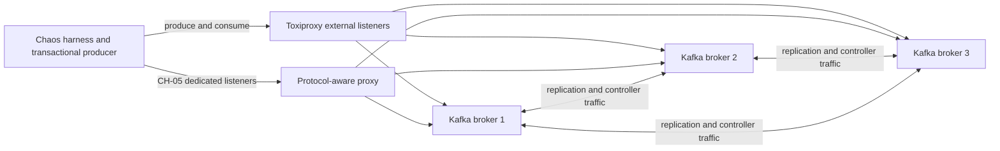
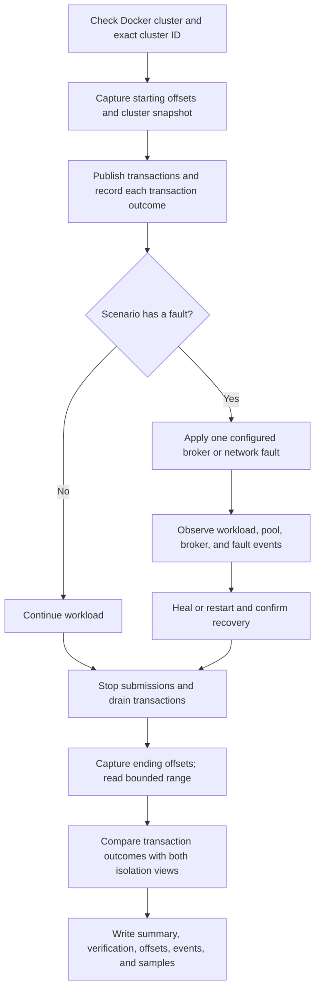

# Kafka chaos testing guide

This guide introduces the disposable Kafka chaos environment, explains how to
run and read a campaign, and records the live results available as of
2026-10-24. It is written for engineers who are new to chaos testing.

> **Safety:** Run these commands only against the local disposable Docker
> cluster. Fault injection requires both `--chaos-enabled true` and the exact
> runtime Kafka cluster ID in `--cluster-allowlist`. Never point this harness
> at production or a shared cluster.

## 1. What this test is doing

The producer continuously writes small transactions. Each transaction has a
run ID, a publish ID, and record indexes in its headers. The harness records
each transaction's outcome—committed, aborted, or ambiguous—in a results file.
This per-run record of expected outcomes is called the **transaction ledger**;
it is test-harness bookkeeping, not Kafka's internal transaction log. The
harness injects a broker or network fault where requested, then independently
reads the bounded Kafka offset range using both consumer isolation settings.
It compares those Kafka records with the transaction ledger.

The comparison is the key idea: a successful callback alone does not prove
that every expected record is present exactly once, and a broker being healthy
again does not prove that the application recovered correctly.

### Local topology



Producer connections pass through Toxiproxy. Kafka replication and controller
traffic stays on Docker's internal network, so CH-02/03/04 partition the
producer from brokers while leaving the Kafka cluster itself connected. This
distinction matters when interpreting a result: these runs test client
connectivity and pool recovery, not a Kafka inter-broker network partition.

### Run and verification flow



An experiment is meaningful only if injection, recovery, bounded read-back,
and cleanup all have evidence. A missing event or verifier timeout lowers the
evidence quality even if the producer reported no error.

## 2. Start the disposable environment

From the repository root:

```bash
./scripts/chaos-cluster.sh up
CLUSTER_ID="$(./scripts/chaos-cluster.sh cluster-id)"
./scripts/chaos-cluster.sh status
```

`up` starts three Kafka brokers and Toxiproxy, initializes the three producer
listeners, and creates `chaos-perf-test` and `chaos-audit-test` with 12
partitions, replication factor 3, and `min.insync.replicas=2`. Keep the printed
cluster ID; fault scenarios must use that exact value as a safety allowlist.

For CH-01, prepare its disposable topic with preferred leader counts 6/3/3:

```bash
./scripts/chaos-cluster.sh prepare-ch01
```

The Maven command must name the runner explicitly. For example, a baseline run
is:

```bash
mvn -Pchaos compile exec:java \
  -Dexec.mainClass=com.kafka.producer.chaos.ChaosRunner \
  -Dexec.args="--scenario MB-01 --duration-sec 120 \
  --output-topics chaos-perf-test,chaos-audit-test \
  --results-dir chaos-results"
```

For a fault run, add the opt-in, exact cluster ID, and scenario-specific hook.
For example, a one-broker producer partition:

```bash
mvn -Pchaos compile exec:java \
  -Dexec.mainClass=com.kafka.producer.chaos.ChaosRunner \
  -Dexec.args="--scenario CH-02 --duration-sec 60 --fault-at-sec 20 \
  --fault-duration-sec 20 --chaos-enabled true \
  --cluster-allowlist ${CLUSTER_ID} \
  --partition-broker-command './scripts/chaos-network.sh partition-broker {brokerId}' \
  --heal-network-command './scripts/chaos-network.sh heal' \
  --results-dir chaos-results"
```

CH-05 must use the protocol-aware listener ports so that Kafka metadata routes
every broker connection through the protocol proxy. `chaos-cluster.sh up`
starts those listeners and the proxy alongside Toxiproxy. This command arms the
proxy at 10 seconds, drops broker responses for forwarded `EndTxn` requests
until it disarms at 50 seconds. The 40-second hold exceeds the producer's
10-second `request.timeout.ms`. It uses one worker and one pool slot to bound
the fault workload. The proxy withholds EndTxn responses while armed and keeps
the connection open, allowing the Kafka client's configured request timeout to
surface as an ambiguous commit outcome instead of an immediate disconnect and
transparent retry:

```bash
mvn -Pchaos compile exec:java \
  -Dexec.mainClass=com.kafka.producer.chaos.ChaosRunner \
  -Dexec.args="--scenario CH-05 --bootstrap-servers localhost:19192,localhost:29192,localhost:39192 \
  --duration-sec 70 --fault-at-sec 10 --fault-duration-sec 40 \
  --pool-size 1 --threads 1 \
  --chaos-enabled true --cluster-allowlist ${CLUSTER_ID} \
  --commit-response-command './scripts/chaos-protocol-proxy.sh arm' \
  --heal-network-command './scripts/chaos-protocol-proxy.sh heal' \
  --results-dir chaos-results"
```

The CH-05 event log records each proxy-forwarded `EndTxn` request, dropped
response, matching correlation ID, and the broker's transaction-state query
for the transaction ID parsed from that request. The result is **PASS** only
if the proxy confirms a matching request/response pair, broker state is
captured, at least one transaction outcome is ambiguous, and the standard
record verifier passes. Missing protocol or broker-state proof, or missing
ambiguity, is
**INVALID/INCOMPLETE**; correctness violations with those observations are
**FAIL**.

CH-10 uses the same protocol listeners. It waits for the configured
`request.timeout.ms` plus two seconds after arming the proxy, captures broker
transaction states while they still show the commit outcome, then fences each
pool transactional ID. Set the fault window longer than the request timeout
plus two seconds. Example with the default 10-second request timeout:

```bash
mvn -Pchaos compile exec:java \
  -Dexec.mainClass=com.kafka.producer.chaos.ChaosRunner \
  -Dexec.args="--scenario CH-10 --bootstrap-servers localhost:19192,localhost:29192,localhost:39192 \
  --duration-sec 70 --fault-at-sec 10 --fault-duration-sec 40 \
  --pool-size 2 --threads 2 \
  --chaos-enabled true --cluster-allowlist ${CLUSTER_ID} \
  --commit-response-command './scripts/chaos-protocol-proxy.sh arm' \
  --capture-commit-response-command './scripts/chaos-protocol-proxy.sh capture' \
  --heal-network-command './scripts/chaos-protocol-proxy.sh heal' \
  --results-dir chaos-results"
```

## 3. Scenario catalog and observed results

The catalog below brings the original multi-broker and network scenarios and
CH-06 through CH-15 together. It describes the fault that was actually run,
what the verifier observed, and where to inspect the run artifacts. Results are
from disposable local Docker clusters; they are evidence for these specific
runs, not guarantees for other Kafka versions or workloads.

The Oct 23 campaigns used Kafka 3.7.0 and a three-broker KRaft cluster. MB-01
through CH-05 used the parameters recorded in `chaos-results/summary.md`; MB-02's
corrected run is in `chaos-results-recheck/summary.md`. The Oct 24 review-branch
campaign used the same Kafka version and topology, one 12-partition
`chaos-perf-test` topic, pool size 2, two workers, five records per transaction,
and 64-byte records for CH-06 through CH-15. Fault scenarios were enabled only
for the disposable cluster's exact runtime cluster ID. CH-10 was then rerun
with pre-fencing broker-state capture; that corrected run is reported separately
in its own result directory.

**PASS** means both the scenario-specific fault evidence and bounded Kafka
read-back passed. Ambiguous outcomes are counted separately from confirmed
commits. **INVALID/INCOMPLETE** means the run did not prove the required fault
was exercised; it is not a correctness pass. A correctness violation after
valid fault evidence is **FAIL**. The artifact links open the summary index;
run IDs identify the specific row inside that file and its matching CSV, event,
offset, partition-count, and verification artifacts.

`MB-*` covers workload baselines, partition distribution, and broker failures.
`CH-*` covers client network faults and producer/pool lifecycle failures. The
`AF-*` names in the separate agentic campaign describe planner hypothesis
families, not additional direct-runner scenario IDs.

| ID | What was done | What the run showed | Run result and artifacts |
|---|---|---|---|
| **MB-01** | 120s transactional baseline across two output topics; 10 records per topic per transaction; deliberately abort every 10th publish to exercise isolation. | 32,250 ledger outcomes: 29,029 committed and 3,221 aborted. `read_committed` contained 580,580 committed records and none of the 64,420 aborted records; `read_uncommitted` contained all 645,000. No missing, duplicate, partial, or cross-topic mismatches. | **PASS**. Run `MB-01-2026-10-23T04-42-06.359142003Z`. [Artifacts](chaos-results/summary.md) |
| **MB-02** | 30s baseline routing 10 records per transaction across two topics, each with 12 partitions; records distributed round-robin. | 8,569 commits and 171,380 records in each isolation view. All 24 topic-partitions were sampled; zero per-partition/key ordering violations. | **PASS** (corrected run). `MB-02-2026-10-23T04-44-16.741371760Z`. [Artifacts](chaos-results-recheck/summary.md) |
| **MB-03** | 60s run; stop a non-leader replica for the configured target partition for 20s, restart it, and wait for broker recovery. | 15,403 commits; 154,030 records in each isolation view. Broker recovery completed and read-back found no missing or duplicate records. | **PASS**. `MB-03-2026-10-23T06-13-14.625158912Z`. [Artifacts](chaos-results/summary.md) |
| **MB-04** | 60s run; stop the target partition's leader for 20s, then restart the broker. | 16,270 commits; 162,700 records in each isolation view. A replacement leader served the partition; the broker recovered and read-back found no missing or duplicate records. | **PASS**. `MB-04-2026-10-23T06-14-27.406718152Z`. [Artifacts](chaos-results/summary.md) |
| **CH-01** | 180s sustained run after assigning preferred leaders 6/3/3 across brokers; restart the leader-heavy broker (broker 1) during the run. | 46,156 commits; 923,120 records in each isolation view. Restart and healthy recovery confirmed; no missing or duplicate records. | **PASS**. `CH-01-2026-10-23T05-01-21.160003912Z`. [Artifacts](chaos-results/summary.md) |
| **CH-02** | 60s run; block producer traffic to one broker that leads a partition for 20s, then heal the network. Kafka's internal broker traffic remains connected. | 11,300 outcomes: 11,299 committed and 1 ambiguous. No acknowledged records were missing and no duplicates were found; network healing was confirmed. | **PASS**. `CH-02-2026-10-23T06-15-35.404673402Z`. [Artifacts](chaos-results/summary.md) |
| **CH-03** | 60s run; block producer traffic to all brokers for 20s, then restore connectivity. The broker cluster itself remains connected. | 8,180 outcomes: 8,172 committed and 8 ambiguous. No acknowledged records were missing and no duplicates were found; network healing was confirmed. | **PASS**. `CH-03-2026-10-23T06-16-43.386937395Z`. [Artifacts](chaos-results/summary.md) |
| **CH-04** | 215s run with two workers; inject six producer-to-cluster partitions, each followed by a healthy interval. | All 6 faults healed. Blocked intervals measured 9.6–11.6s; the five healthy intervals measured 20.2–21.6s. 30,516 commits / 305,160 records in each isolation view; zero missing, duplicate, partial, or cross-topic mismatches. | **PASS**. `CH-04-2026-10-23T06-35-12.631653134Z`. [Artifacts](chaos-results/summary.md) |
| **CH-05** | 70s run with one worker and one pool slot; for 40s, a protocol-aware proxy forwards Kafka `EndTxn` requests but drops their correlated responses while keeping connections open. | 687 outcomes: 685 committed and 2 ambiguous timeouts. Proxy evidence showed 4/4 matching responses dropped; coordinator state reported `CompleteCommit`. All 6,870 records were visible in each isolation view, including records from both ambiguous publishes; no replay, missing, duplicate, partial, or pending outcomes. | **PASS** (protocol-qualified run). `CH-05-2026-10-23T08-11-43.581397410Z`. [Artifacts](chaos-results/summary.md) |
| **CH-06** | 30s run; fence one of two pool producers by initializing an external producer with the same transactional ID. The pool must evict and rebuild that slot. | One producer fence and recovery to full pool capacity. 1,645 ledger outcomes; zero missing, duplicate, partial, ordering, or replay issues. | **PASS**. `CH-06-2026-10-24T02-16-46.678097773Z`. [Artifacts](chaos-results-review-20261024/summary.md) |
| **CH-07** | 30s run; fence both pool producers during the run; require both slots to be replaced and the pool to return to full capacity. | Both slots were fenced; full-capacity recovery completed. 1,226 ledger outcomes; no record-verification issues. | **PASS**. `CH-07-2026-10-24T02-17-29.400900925Z`. [Artifacts](chaos-results-review-20261024/summary.md) |
| **CH-08** | 40s run; repeatedly fence rotating producer slots, 10s apart, during a 25s fault window. | Three rotating fences and three recoveries were confirmed. 1,688 ledger outcomes; no record-verification issues. | **PASS**. `CH-08-2026-10-24T02-19-02.736935507Z`. [Artifacts](chaos-results-review-20261024/summary.md) |
| **CH-09** | 45s run; fence one producer, then one second later partition the client from all brokers for 25s so replacement `initTransactions` must retry; heal and require full capacity. | The pool dropped below full capacity during the partition and recovered after healing. 643 ledger outcomes, 2 ambiguous; no missing, duplicate, partial, or callback-replay issues. | **PASS** (25s partition). `CH-09-2026-10-24T02-20-36.569708886Z`. [Artifacts](chaos-results-review-20261024/summary.md) |
| **CH-10** | 70s run; drop correlated `EndTxn` responses for 40s with two pool slots. After the 10s request timeout plus 2s grace, capture coordinator state before fencing both pool transactional IDs. | Four matching response drops; both IDs showed pre-fencing `CompleteCommit`. 1,054 ledger outcomes, 4 ambiguous; 1,054 publish IDs observed, zero missing, duplicate, partial, or replayed publishes, and no pending transactions. | **PASS** (corrected pre-fence proof). `CH-10-2026-10-24T02-34-14.361441655Z`. [Corrected run artifacts](chaos-results-ch10-fix-20261024/summary.md) |
| **CH-11** | 30s run; force one in-process pool restart during load with a 1ms shutdown grace period. The replacement pool reuses the same transactional IDs. | Restart completed; pool returned to full capacity. 1,218 ledger outcomes and no record-verification issues. | **PASS**. `CH-11-2026-10-24T02-23-06.855083267Z`. [Artifacts](chaos-results-review-20261024/summary.md) |
| **CH-12** | 30s run; gracefully shut down and restart the pool once during load, reusing the same transactional IDs. | Graceful restart completed; pool returned to full capacity. 1,776 ledger outcomes and no record-verification issues. | **PASS**. `CH-12-2026-10-24T02-23-42.446060885Z`. [Artifacts](chaos-results-review-20261024/summary.md) |
| **CH-13** | 35s run; perform three in-process pool restarts 10s apart during load, like a rolling application restart. | All three restarts completed; pool returned to full capacity. 1,691 ledger outcomes and no record-verification issues. | **PASS**. `CH-13-2026-10-24T02-24-22.089623110Z`. [Artifacts](chaos-results-review-20261024/summary.md) |
| **CH-14** | 45s run; set `transaction.timeout.ms` to 15s and stall one transaction for 20s after sending records. The coordinator should abort it; the failed commit should fence/evict the producer and trigger rebuild. | Timeout fault evidence and full-capacity recovery were observed. 1,928 ledger outcomes; no missing, duplicate, or partial publishes. The stalled transaction did not leak partial data into committed output. | **PASS** (15s timeout / 20s stall). `CH-14-2026-10-24T02-26-33.590901498Z`. [Artifacts](chaos-results-review-20261024/summary.md) |
| **CH-15** | 35s run; locate and stop the broker coordinating a pool transactional ID for a configured 10s window; restart it and observe retriable coordinator behavior. | Broker 1 was stopped and restarted (6.7s observed); pool returned to full capacity. 1,578 ledger outcomes and no record-verification issues. | **PASS**. `CH-15-2026-10-24T02-25-32.101152647Z`. [Artifacts](chaos-results-review-20261024/summary.md) |

### Run history and caveats

- Before the review-branch sources were brought into the working tree, the
  initial checkout's `mvn -Pchaos test` run had 14 chaos tests pass. The full
  56-test Maven run was incomplete: 19 tests errored because Mockito/Byte Buddy
  could not self-attach to the JVM. Docker access was unavailable during that
  attempt, so it produced no broker-backed results.
- The review-branch chaos suite then passed 66 tests, including all 7 tests in
  `PoolLifecycleScenariosTest`. After the CH-10 correction, `mvn -Pchaos test`
  passed 68 tests with no failures, errors, or skips.
- The first CH-09 10s partition was **INVALID/INCOMPLETE**: the pool never lost
  capacity, so rebuild failure was not exercised. The 25s partition listed
  above exercised the intended condition and passed.
- Early CH-10 attempts were not qualified: one bypassed the protocol proxy;
  another captured state only after fencing and returned `Empty`. The corrected
  run above captures `CompleteCommit` before fencing and is the qualified result.
- CH-14's 6s-timeout attempt and a shorter repeat were **INVALID/INCOMPLETE**
  because they did not produce the required fencing evidence. The table reports
  the successful 15s-timeout / 20s-stall run; the shorter variation means this
  result has not been shown to be repeatable.
- The TCP-only CH-05 attempt is **INVALID/INCOMPLETE** because it did not prove
  that a correlated `EndTxn` response was dropped. The table reports the later
  protocol-aware run; diagnostics and earlier attempts remain in
  [`chaos-results/summary.md`](chaos-results/summary.md).

The review-branch Docker campaign used cluster ID
`5L6g3nShT-eMCtK--X86sw`. The disposable containers, network, and volumes were
stopped and removed after the runs; Toxiproxy had zero active toxics and the
protocol proxy was disarmed. Use the run IDs above when locating artifacts in
the linked summaries.

## 4. Parameters: what they control and why they are used

The table describes the direct chaos runner's important options. Defaults are
from the current harness; campaign values above are the values used in the
recorded runs. Explicitly set a parameter when the experiment depends on it so
the result can be repeated and interpreted later.

| Parameter | Default / example | Why this parameter matters | What evidence checks it |
|---|---|---|---|
| `--scenario` | Required; e.g. `MB-01`, `CH-04` | Selects one defined fault hypothesis and its required hooks | Run summary and event log identify scenario and outcome |
| `--duration-sec` | 600s default; recorded runs used 30–215s | Gives a known workload window; include time before, during, and after a fault | Start/end timestamps, samples, ledger totals, and ending offsets |
| `--fault-at-sec` | 180s | Schedules fault relative to the run so baseline and fault periods can be compared | Event timestamps show requested/applied fault relative to run |
| `--fault-duration-sec` | 60s | Bounds an outage and allows an explicit recovery interval | Fault/heal events and recovery checks; CH-04 uses its six-cycle schedule |
| `--topic` / `--output-topics` | One topic unless configured; examples use publish and audit topics | Multiple topics let the verifier test whether each transaction's records commit or abort together | Per-publish verification compares expected records across output topics |
| `--partition-count` | 12 | Gives MB-02 a defined topology and routes records across partitions | Per-partition totals; MB-02 requires a committed sample from each configured topic-partition |
| `--records-per-tx` | 10 | Makes transaction completeness countable; changing it changes expected records per publish | Ledger's expected record count compared with observed IDs/indexes |
| `--abort-every` | 10 for MB-01; 0 for other scenarios | Deliberate aborts create a known negative case to verify isolation semantics | Aborted IDs/record counts must be absent in `read_committed`, present in `read_uncommitted` |
| `--chaos-enabled` | `false`; must be `true` for faults | Prevents accidental fault injection when running a baseline or misconfigured command | Config validation refuses fault runs without the opt-in |
| `--cluster-allowlist` | Empty; set to runtime cluster ID | Binds the fault to the disposable cluster the operator inspected | Startup compares connected cluster identity to the allowed ID |
| Fault and heal command hooks | Scenario-specific scripts | Make fault action and cleanup explicit, reviewable, and repeatable | Event log records action; post-run checks require heal/restart and healthy state |
| `--recovery-timeout-sec` | 120s | Gives the application and cluster a finite recovery deadline | Recovery events and pending transaction/lease checks at drain |

Other load controls such as worker count, record size, and lease timeout should
also be recorded when varied. A result is comparable only when its workload
shape and fault timing are understood; a count without its duration and load
does not say how fast the system was operating.

## 5. What is checked, and why the evidence is useful

| Check | Pass meaning | Why it is useful / trust basis | Limit |
|---|---|---|---|
| Missing committed publishes | Every acknowledged publish ID and expected record index is visible exactly once in `read_committed` | Reconciles producer callback outcomes to an independent Kafka read-back | Only covers the run IDs and captured offset interval |
| Duplicate IDs or indexes | No publish ID/record index appears more than once | Detects replay or duplicate output even if total record counts look correct | A simple total count alone would not detect a missing record balanced by a duplicate; use the per-publish CSV |
| Partial transactions | A publish has either all expected records or none in committed view | Checks transaction boundaries rather than only throughput | Depends on configured `records-per-tx` and topic set |
| Cross-topic consistency | Each transaction's expected records agree across configured output topics | Directly checks atomic outcome across the topics in that run | Does not establish atomicity for topics that were not configured |
| Aborted visibility | Known aborted records are hidden in `read_committed` and accounted for in `read_uncommitted` | Tests both Kafka isolation views with a known set of intentional aborts | Requires the intentional abort scenario and complete scan of the captured range |
| Ordering | Sequence order is checked by topic, partition, and key | Kafka guarantees order within a partition, not globally across partitions/topics | Not a global ordering guarantee; business keys must route consistently |
| Fault and recovery | Fault application, healing/restart, and recovery are recorded within deadlines | Distinguishes a real injected experiment from a workload that merely ran near a fault command | Docker health and proxy events prove environment state, not every client-level effect |
| Ambiguous outcomes | Unknown commit outcomes are reported as ambiguous and not counted as acknowledged success | Avoids falsely claiming success or retrying a possibly committed transaction | Ambiguity alone does not prove a response was lost; CH-05 also requires the proxy's matching `EndTxn` request/response evidence |
| Cleanup | No active toxics; brokers healthy; full ISR restored before next run | Ensures one campaign does not contaminate the next | Verify this explicitly after interruption or timeout |

### Why the measurements are reasonably trustworthy

The verifier uses more than a producer's success counter. It correlates
run-scoped publish IDs and record indexes from the producer ledger with records
read back from Kafka. It captures starting and ending offsets and limits the
scan to that range, then writes per-publish and per-partition detail. Event
records separately show fault request/application, healing, and verification.
Together these let a reviewer reproduce the count and inspect individual
exceptions.

Trust is bounded: these are finite runs on one local Docker topology, under
the recorded workload and timing. They do not prove behavior for every broker
version, production load, or untested configuration. The earlier CH-05 artifact
is not valid protocol-level commit-response-loss evidence: `drop-responses`
suppressed downstream Kafka traffic broadly and did not prove that a correlated
`EndTxn` response was dropped. The current direct CH-05 path uses a
protocol-aware proxy that records the forwarded request and drops its matching
response. The new event evidence qualifies the fault injection; it does not
replace the independent transaction read-back or extend the result beyond this
specific local run.

## 6. Inspecting a run

The direct runner writes files under `chaos-results/` (MB-02's corrected run
is under `chaos-results-recheck/`). Start with the summary, then inspect the
per-publish and event evidence for the run ID:

```bash
cat chaos-results/summary.md
ls -1 chaos-results/MB-01-2026-10-23T04-42-06.359142003Z*
head -n 5 chaos-results/MB-01-2026-10-23T04-42-06.359142003Z-verification.csv
cat chaos-results/MB-01-2026-10-23T04-42-06.359142003Z-events.jsonl
```

Artifact meanings:

| File | What it contains |
|---|---|
| `summary.md` | Numeric totals and overall verification status |
| `*-verification.csv` | Per-publish ledger outcome, expected records, observed records under each isolation level, callback attempts/errors |
| `*-offsets.csv` | Start/end offsets defining the verifier's scan boundaries |
| `*-partition-counts.csv` | Read-committed record counts by topic and partition |
| `*-events.jsonl` | Cluster snapshots, fault request/application, heal, cleanup, and verification events |
| `*.csv` time-series | Per-second throughput, outcomes, latency, pool/lease/producer, memory, and broker health samples |

For example, the number `64,420` in MB-01 is the total expected aborted data
records observed under `read_uncommitted`; it is 3,221 aborted transactions
multiplied by 20 records per transaction across two output topics. Those same
aborted records must contribute zero to the committed view. When reporting a
number, say which artifact field and which view it came from.

## 7. Reading the MB-01 isolation counts

MB-01 is a useful example of why a single total-record count is not enough.
The run wrote 32,250 transactions to two output topics. Each transaction
contained 10 records in each topic, or 20 records total. Of those transactions,
29,029 committed and 3,221 were deliberately aborted:

| Outcome | Calculation | Visible in `read_committed` | Visible in `read_uncommitted` |
|---|---:|---:|---:|
| Committed | 29,029 × 20 = 580,580 records | 580,580 | 580,580 |
| Aborted | 3,221 × 20 = 64,420 records | 0 | 64,420 |
| Total visible |  | **580,580** | **645,000** |

`read_uncommitted` sees the committed records plus aborted records;
`read_committed` hides the aborted records. The verifier also matches publish
IDs and record indexes, so a missing record balanced by a duplicate cannot hide
behind matching grand totals. The complete scenario catalog and result links
are in [Section 3](#3-scenario-catalog-and-observed-results).

## 8. Fault and cleanup commands

```bash
# Block producer traffic to one broker in both directions.
./scripts/chaos-network.sh partition-broker 1

# Block producer traffic to all brokers in both directions.
./scripts/chaos-network.sh partition-cluster

# Allow requests upstream but suppress downstream responses from all brokers.
./scripts/chaos-network.sh drop-responses

# Remove every network fault; safe to repeat.
./scripts/chaos-network.sh heal

# Show each proxy and its number of active toxics.
./scripts/chaos-network.sh status

# Confirm the CH-05 protocol proxy is disarmed and inspect its last proof.
./scripts/chaos-protocol-proxy.sh status
```

After an interrupted run or uncertain cleanup, heal and check the environment
before continuing:

```bash
./scripts/chaos-network.sh heal
./scripts/chaos-network.sh status
./scripts/chaos-cluster.sh status
```

Each Toxiproxy listener should report zero active toxics, the CH-05 proxy should
report `"armed": false`, every container should be healthy, and all topic
partitions should have all three brokers in ISR. Stop the environment after
experiments:

```bash
./scripts/chaos-network.sh heal
./scripts/chaos-cluster.sh down
```
