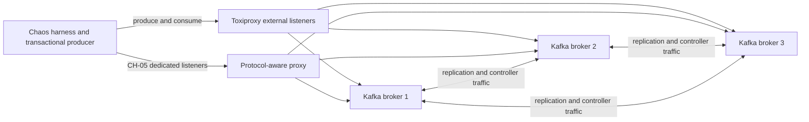
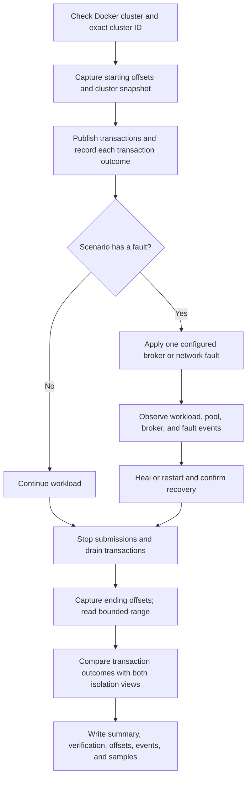

# Kafka chaos testing guide

This guide introduces the disposable Kafka chaos environment, explains how to
run and read a campaign, and records the live results available as of
2026-10-23. It is written for engineers who are new to chaos testing.

> **Safety:** Run these commands only against the local disposable Docker
> cluster. Fault injection requires both `--chaos-enabled true` and the exact
> runtime Kafka cluster ID in `--cluster-allowlist`. Never point this harness
> at production or a shared cluster.

## 1. What this test is doing

The producer continuously writes small transactions. Each transaction has a
run ID, a publish ID, and record indexes in its headers. The harness records
each transaction's outcome—committed, aborted, or ambiguous—in a results file.
This per-run record of expected outcomes is called the **transaction ledger**;
it is test-harness bookkeeping, not Kafka's internal transaction log. The
harness injects a broker or network fault where requested, then independently
reads the bounded Kafka offset range using both consumer isolation settings.
It compares those Kafka records with the transaction ledger.

The comparison is the key idea: a successful callback alone does not prove
that every expected record is present exactly once, and a broker being healthy
again does not prove that the application recovered correctly.

### Local topology



Producer connections pass through Toxiproxy. Kafka replication and controller
traffic stays on Docker's internal network, so CH-02/03/04 partition the
producer from brokers while leaving the Kafka cluster itself connected. This
distinction matters when interpreting a result: these runs test client
connectivity and pool recovery, not a Kafka inter-broker network partition.

### Run and verification flow



An experiment is meaningful only if injection, recovery, bounded read-back,
and cleanup all have evidence. A missing event or verifier timeout lowers the
evidence quality even if the producer reported no error.

## 2. Start the disposable environment

From the repository root:

```bash
./scripts/chaos-cluster.sh up
CLUSTER_ID="$(./scripts/chaos-cluster.sh cluster-id)"
./scripts/chaos-cluster.sh status
```

`up` starts three Kafka brokers and Toxiproxy, initializes the three producer
listeners, and creates `chaos-perf-test` and `chaos-audit-test` with 12
partitions, replication factor 3, and `min.insync.replicas=2`. Keep the printed
cluster ID; fault scenarios must use that exact value as a safety allowlist.

For CH-01, prepare its disposable topic with preferred leader counts 6/3/3:

```bash
./scripts/chaos-cluster.sh prepare-ch01
```

The Maven command must name the runner explicitly. For example, a baseline run
is:

```bash
mvn -Pchaos compile exec:java \
  -Dexec.mainClass=com.kafka.producer.chaos.ChaosRunner \
  -Dexec.args="--scenario MB-01 --duration-sec 120 \
  --output-topics chaos-perf-test,chaos-audit-test \
  --results-dir chaos-results"
```

For a fault run, add the opt-in, exact cluster ID, and scenario-specific hook.
For example, a one-broker producer partition:

```bash
mvn -Pchaos compile exec:java \
  -Dexec.mainClass=com.kafka.producer.chaos.ChaosRunner \
  -Dexec.args="--scenario CH-02 --duration-sec 60 --fault-at-sec 20 \
  --fault-duration-sec 20 --chaos-enabled true \
  --cluster-allowlist ${CLUSTER_ID} \
  --partition-broker-command './scripts/chaos-network.sh partition-broker {brokerId}' \
  --heal-network-command './scripts/chaos-network.sh heal' \
  --results-dir chaos-results"
```

CH-05 must use the protocol-aware listener ports so that Kafka metadata routes
every broker connection through the protocol proxy. `chaos-cluster.sh up`
starts those listeners and the proxy alongside Toxiproxy. This command arms the
proxy at 10 seconds, drops broker responses for forwarded `EndTxn` requests
until it disarms at 50 seconds. The 40-second hold exceeds the producer's
10-second `request.timeout.ms`. It uses one worker and one pool slot to bound
the fault workload. The proxy withholds EndTxn responses while armed and keeps
the connection open, allowing the Kafka client's configured request timeout to
surface as an ambiguous commit outcome instead of an immediate disconnect and
transparent retry:

```bash
mvn -Pchaos compile exec:java \
  -Dexec.mainClass=com.kafka.producer.chaos.ChaosRunner \
  -Dexec.args="--scenario CH-05 --bootstrap-servers localhost:19192,localhost:29192,localhost:39192 \
  --duration-sec 70 --fault-at-sec 10 --fault-duration-sec 40 \
  --pool-size 1 --threads 1 \
  --chaos-enabled true --cluster-allowlist ${CLUSTER_ID} \
  --commit-response-command './scripts/chaos-protocol-proxy.sh arm' \
  --heal-network-command './scripts/chaos-protocol-proxy.sh heal' \
  --results-dir chaos-results"
```

The CH-05 event log records each proxy-forwarded `EndTxn` request, dropped
response, matching correlation ID, and the broker's transaction-state query
for the transaction ID parsed from that request. The result is **PASS** only
if the proxy confirms a matching request/response pair, broker state is
captured, at least one transaction outcome is ambiguous, and the standard
record verifier passes. Missing protocol or broker-state proof, or missing
ambiguity, is
**INVALID/INCOMPLETE**; correctness violations with those observations are
**FAIL**.

## 3. Results from the completed Docker campaigns

These are observed results from the artifacts listed below, not promises about
future runs or performance guarantees. “Committed” is the number of ledger
transactions whose commit callback completed successfully. “Records” is the
number of records found in the verifier's captured offset range. Each
transaction contained 10 records in these runs. `read_uncommitted` can include
records from aborted transactions, so its total is not expected to equal the
`read_committed` total in MB-01.

| Scenario | Parameters and fault | Counted result | Correctness result | Artifact and status |
|---|---|---|---|---|
| MB-01 | 120s; 2 topics; default deliberate abort every 10 publishes | 32,250 ledger outcomes: 29,029 committed, 3,221 aborted; 580,580 records read committed; 645,000 read uncommitted, including 64,420 aborted records | 0 missing, duplicate, partial, or cross-topic mismatches; aborted records absent from `read_committed` and present in `read_uncommitted` | `MB-01-2026-10-23T04-42-06.359142003Z` — **PASS** |
| MB-02 | 30s; 12 partitions round-robin across 2 topics | 8,569 committed; 171,380 records under each isolation level; all 24 topic-partitions sampled | 0 ordering violations | `chaos-results-recheck/MB-02-2026-10-23T04-44-16.741371760Z` — **PASS** |
| CH-01 | 180s; broker 1 restarted; preferred leader distribution 6/3/3 | 46,156 committed; 923,120 records under each isolation level | Restart and healthy recovery confirmed; 0 missing or duplicate records | `CH-01-2026-10-23T05-01-21.160003912Z` — **PASS** |
| MB-03 | 60s; non-leader replica stopped for 20s | 15,403 committed; 154,030 records under each isolation level | Broker restart/recovery confirmed | `MB-03-2026-10-23T06-13-14.625158912Z` — **PASS** |
| MB-04 | 60s; target partition leader stopped for 20s | 16,270 committed; 162,700 records under each isolation level | Broker restart/recovery confirmed | `MB-04-2026-10-23T06-14-27.406718152Z` — **PASS** |
| CH-02 | 60s; producer blocked from one leader broker for 20s | 11,300 outcomes: 11,299 committed, 1 ambiguous; 112,990 read committed and 113,000 read uncommitted | No missing acknowledged records or duplicates; network healing confirmed | `CH-02-2026-10-23T06-15-35.404673402Z` — **PASS** |
| CH-03 | 60s; producer blocked from all brokers for 20s | 8,180 outcomes: 8,172 committed, 8 ambiguous; 81,720 read committed and 81,780 read uncommitted | No missing acknowledged records or duplicates; network healing confirmed | `CH-03-2026-10-23T06-16-43.386937395Z` — **PASS** |
| CH-04 | 215s; 2 workers; six blocked/healed cycles | 30,516 committed; 305,160 records under each isolation level | 6/6 faults healed; 0 missing, duplicate, partial, or cross-topic mismatches; blocked windows measured 9.6–11.6s and five healthy intervals 20.2–21.6s | `CH-04-2026-10-23T06-35-12.631653134Z` — **PASS** |
| CH-05 | 70s; 40s response hold from second 10; one worker and one pool slot | 687 outcomes: 685 committed, 2 ambiguous (`TimeoutException`); 6,870 records under each isolation level | 4/4 EndTxn responses dropped with matching correlation IDs; broker state query reported `CompleteCommit`; 0 missing, duplicate, replayed, or pending outcomes; each ambiguous publish's 10 records were visible under both isolation levels | `CH-05-2026-10-23T08-11-43.581397410Z` — **PASS** |

The earlier TCP-only CH-05 run
(`CH-05-2026-10-23T06-17-54.870349108Z`) remains **INVALID/INCOMPLETE** and
is retained as historical evidence. Other direct CH-05 attempts in
`chaos-results/summary.md` are diagnostic and unqualified; the table's
08:11:43 run is the only one with the complete protocol, ambiguity, broker
state, and record-verification evidence. The artifact directory contains the run
ID in each filename. The detailed
assessment, including earlier harness defects and the historical AF-05
interpretation, is in
[`agentic-results/coverage-assessment-2026-10-23.md`](agentic-results/coverage-assessment-2026-10-23.md).
Earlier diagnostic runs are retained in summaries; use the exact artifact IDs
in this table when citing the corrected live results.

## 4. Parameters: what they control and why they are used

The table describes the direct chaos runner's important options. Defaults are
from the current harness; campaign values above are the values used in the
recorded runs. Explicitly set a parameter when the experiment depends on it so
the result can be repeated and interpreted later.

| Parameter | Default / example | Why this parameter matters | What evidence checks it |
|---|---|---|---|
| `--scenario` | Required; e.g. `MB-01`, `CH-04` | Selects one defined fault hypothesis and its required hooks | Run summary and event log identify scenario and outcome |
| `--duration-sec` | 600s default; recorded runs used 30–215s | Gives a known workload window; include time before, during, and after a fault | Start/end timestamps, samples, ledger totals, and ending offsets |
| `--fault-at-sec` | 180s | Schedules fault relative to the run so baseline and fault periods can be compared | Event timestamps show requested/applied fault relative to run |
| `--fault-duration-sec` | 60s | Bounds an outage and allows an explicit recovery interval | Fault/heal events and recovery checks; CH-04 uses its six-cycle schedule |
| `--topic` / `--output-topics` | One topic unless configured; examples use publish and audit topics | Multiple topics let the verifier test whether each transaction's records commit or abort together | Per-publish verification compares expected records across output topics |
| `--partition-count` | 12 | Gives MB-02 a defined topology and routes records across partitions | Per-partition totals; MB-02 requires a committed sample from each configured topic-partition |
| `--records-per-tx` | 10 | Makes transaction completeness countable; changing it changes expected records per publish | Ledger's expected record count compared with observed IDs/indexes |
| `--abort-every` | 10 for MB-01; 0 for other scenarios | Deliberate aborts create a known negative case to verify isolation semantics | Aborted IDs/record counts must be absent in `read_committed`, present in `read_uncommitted` |
| `--chaos-enabled` | `false`; must be `true` for faults | Prevents accidental fault injection when running a baseline or misconfigured command | Config validation refuses fault runs without the opt-in |
| `--cluster-allowlist` | Empty; set to runtime cluster ID | Binds the fault to the disposable cluster the operator inspected | Startup compares connected cluster identity to the allowed ID |
| Fault and heal command hooks | Scenario-specific scripts | Make fault action and cleanup explicit, reviewable, and repeatable | Event log records action; post-run checks require heal/restart and healthy state |
| `--recovery-timeout-sec` | 120s | Gives the application and cluster a finite recovery deadline | Recovery events and pending transaction/lease checks at drain |

Other load controls such as worker count, record size, and lease timeout should
also be recorded when varied. A result is comparable only when its workload
shape and fault timing are understood; a count without its duration and load
does not say how fast the system was operating.

## 5. What is checked, and why the evidence is useful

| Check | Pass meaning | Why it is useful / trust basis | Limit |
|---|---|---|---|
| Missing committed publishes | Every acknowledged publish ID and expected record index is visible exactly once in `read_committed` | Reconciles producer callback outcomes to an independent Kafka read-back | Only covers the run IDs and captured offset interval |
| Duplicate IDs or indexes | No publish ID/record index appears more than once | Detects replay or duplicate output even if total record counts look correct | A simple total count alone would not detect a missing record balanced by a duplicate; use the per-publish CSV |
| Partial transactions | A publish has either all expected records or none in committed view | Checks transaction boundaries rather than only throughput | Depends on configured `records-per-tx` and topic set |
| Cross-topic consistency | Each transaction's expected records agree across configured output topics | Directly checks atomic outcome across the topics in that run | Does not establish atomicity for topics that were not configured |
| Aborted visibility | Known aborted records are hidden in `read_committed` and accounted for in `read_uncommitted` | Tests both Kafka isolation views with a known set of intentional aborts | Requires the intentional abort scenario and complete scan of the captured range |
| Ordering | Sequence order is checked by topic, partition, and key | Kafka guarantees order within a partition, not globally across partitions/topics | Not a global ordering guarantee; business keys must route consistently |
| Fault and recovery | Fault application, healing/restart, and recovery are recorded within deadlines | Distinguishes a real injected experiment from a workload that merely ran near a fault command | Docker health and proxy events prove environment state, not every client-level effect |
| Ambiguous outcomes | Unknown commit outcomes are reported as ambiguous and not counted as acknowledged success | Avoids falsely claiming success or retrying a possibly committed transaction | Ambiguity alone does not prove a response was lost; CH-05 also requires the proxy's matching `EndTxn` request/response evidence |
| Cleanup | No active toxics; brokers healthy; full ISR restored before next run | Ensures one campaign does not contaminate the next | Verify this explicitly after interruption or timeout |

### Why the measurements are reasonably trustworthy

The verifier uses more than a producer's success counter. It correlates
run-scoped publish IDs and record indexes from the producer ledger with records
read back from Kafka. It captures starting and ending offsets and limits the
scan to that range, then writes per-publish and per-partition detail. Event
records separately show fault request/application, healing, and verification.
Together these let a reviewer reproduce the count and inspect individual
exceptions.

Trust is bounded: these are finite runs on one local Docker topology, under
the recorded workload and timing. They do not prove behavior for every broker
version, production load, or untested configuration. The earlier CH-05 artifact
is not valid protocol-level commit-response-loss evidence: `drop-responses`
suppressed downstream Kafka traffic broadly and did not prove that a correlated
`EndTxn` response was dropped. The current direct CH-05 path uses a
protocol-aware proxy that records the forwarded request and drops its matching
response. The new event evidence qualifies the fault injection; it does not
replace the independent transaction read-back or extend the result beyond this
specific local run.

## 6. Inspecting a run

The direct runner writes files under `chaos-results/` (MB-02's corrected run
is under `chaos-results-recheck/`). Start with the summary, then inspect the
per-publish and event evidence for the run ID:

```bash
cat chaos-results/summary.md
ls -1 chaos-results/MB-01-2026-10-23T04-42-06.359142003Z*
head -n 5 chaos-results/MB-01-2026-10-23T04-42-06.359142003Z-verification.csv
cat chaos-results/MB-01-2026-10-23T04-42-06.359142003Z-events.jsonl
```

Artifact meanings:

| File | What it contains |
|---|---|
| `summary.md` | Numeric totals and overall verification status |
| `*-verification.csv` | Per-publish ledger outcome, expected records, observed records under each isolation level, callback attempts/errors |
| `*-offsets.csv` | Start/end offsets defining the verifier's scan boundaries |
| `*-partition-counts.csv` | Read-committed record counts by topic and partition |
| `*-events.jsonl` | Cluster snapshots, fault request/application, heal, cleanup, and verification events |
| `*.csv` time-series | Per-second throughput, outcomes, latency, pool/lease/producer, memory, and broker health samples |

For example, the number `64,420` in MB-01 is the total expected aborted data
records observed under `read_uncommitted`; it is 3,221 aborted transactions
multiplied by 20 records per transaction across two output topics. Those same
aborted records must contribute zero to the committed view. When reporting a
number, say which artifact field and which view it came from.

## 7. Scenario catalog

| ID | Scenario | Fault or purpose | Required hook |
|---|---|---|---|
| `MB-01` | Three-broker baseline | Transaction correctness and isolation baseline | None |
| `MB-02` | Partition/leader distribution | Partition routing and per-partition sampling | None |
| `MB-03` | Non-leader broker loss | Stop a non-leader replica for the target partition | Docker |
| `MB-04` | Leader broker loss | Stop the target partition's leader | Docker |
| `CH-01` | Leader-heavy broker restart | Restart a broker with more leaders during sustained load | Docker |
| `CH-02` | One-broker network partition | Block producer traffic to one broker | `partition-broker` and `heal` |
| `CH-03` | Full network partition | Block producer traffic to all brokers | `partition-cluster` and `heal` |
| `CH-04` | Flapping network | Six cycles of 10s blocked and 20s healthy | `partition-cluster` and `heal` |
| `CH-05` | Commit-response loss | Protocol-aware proxy forwards `EndTxn` requests and drops their correlated responses while armed | `chaos-protocol-proxy.sh arm` and `heal` |

MB means multi-broker baseline/failure coverage; CH means chaos fault scenarios.
The `AF-*` agentic hypothesis families propose these same fault primitives
through an additional policy boundary. The planner does not execute directly:
cluster identity, health, duration, load, telemetry, duplicate, budget, and
cleanup checks must accept its typed plan first.

### What each recorded scenario counted

These counts come from the run artifacts in the results table above. A
“committed transaction” is one whose commit callback completed successfully,
as recorded in the transaction ledger; record totals are independent read-back
from Kafka. The differences between
the two isolation views are meaningful only together with the ledger and
per-publish verification.

| Scenario | How to read the counts | What the run demonstrates |
|---|---|---|
| MB-01 | 32,250 transactions split into 29,029 committed and 3,221 aborted. Each transaction wrote 10 records to each of 2 topics (20 total): 29,029 × 20 = 580,580 committed records; 3,221 × 20 = 64,420 aborted records. | `read_committed` returned 580,580; `read_uncommitted` returned 645,000 = 580,580 + 64,420. The aborted records were visible only to `read_uncommitted`; record-level verification found no missing, duplicate, partial, or cross-topic mismatch. |
| MB-02 | 8,569 commits × 20 records across 2 topics = 171,380 records per isolation view. | All 24 topic-partitions (12 per topic) had samples, and the corrected per-partition/key ordering check found 0 violations. |
| CH-01 | 46,156 commits × 20 records across 2 topics = 923,120 records per isolation view. | The leader-heavy broker (6 preferred leaders versus 3 each) restarted during the run and recovered; verification found no missing or duplicate records. |
| MB-03 | 15,403 commits × 10 records = 154,030 records per isolation view while a non-leader replica was stopped for 20 seconds. | The non-leader broker restarted and recovered. The observed committed records were fully visible after read-back. |
| MB-04 | 16,270 commits × 10 records = 162,700 records per isolation view while the target partition leader was stopped for 20 seconds. | A replacement leader served the partition and the stopped broker recovered. The observed committed records were fully visible after read-back. |
| CH-02 | 11,300 outcomes: 11,299 committed and 1 ambiguous. The read-back contained 112,990 committed-view records and 113,000 uncommitted-view records. | Producer access to one leader broker was blocked for 20 seconds and healed. No acknowledged records were missing and no duplicates were found. The ambiguous outcome is reported separately; it is not counted as a confirmed commit. |
| CH-03 | 8,180 outcomes: 8,172 committed and 8 ambiguous. The read-back contained 81,720 committed-view records and 81,780 uncommitted-view records. | Producer access to all brokers was blocked for 20 seconds and healed. No acknowledged records were missing and no duplicates were found. Ambiguous outcomes remain distinct from confirmed commits. |
| CH-04 | 30,516 commits × 10 records = 305,160 records per isolation view over six partition/heal cycles. | All six faults healed. Measured blocked windows were 9.6–11.6 seconds and the five inter-cycle healthy intervals were 20.2–21.6 seconds; correctness checks found no missing, duplicate, partial, or cross-topic mismatch. |
| CH-05 | 687 outcomes: 685 committed and 2 ambiguous (`TimeoutException`). Both read-back views contained 6,870 records; all 10 records from each ambiguous publish appeared in both views. | The proxy recorded 4 forwarded `EndTxn` requests and dropped all 4 broker responses with matching correlation IDs. The event log includes the parsed transactional ID and a Kafka coordinator query reporting `CompleteCommit` at producer epoch 2. There were 0 callback replays, missing records, duplicates, partial transactions, or pending transactions. The earlier TCP-only run remains invalid/incomplete. |

### MB-01 count example: why the isolation totals differ

The recorded MB-01 run wrote 32,250 transactions to two output topics. Each
transaction contained 10 records in each topic, or 20 records total. Of those
transactions, 29,029 committed and 3,221 were deliberately aborted to create a
known isolation test case:

| Outcome | Calculation | Visible in `read_committed` | Visible in `read_uncommitted` |
|---|---:|---:|---:|
| Committed | 29,029 × 20 = 580,580 records | 580,580 | 580,580 |
| Aborted | 3,221 × 20 = 64,420 records | 0 | 64,420 |
| Total visible |  | **580,580** | **645,000** |

So `read_uncommitted` sees 645,000 records: the 580,580 committed records
plus 64,420 records from aborted transactions. `read_committed` hides those
aborted records. This is the expected Kafka behavior, and the deliberate
aborts make the test stronger than checking committed traffic alone. The
verifier also matches publish IDs and record indexes; matching only the grand
totals could hide one missing record balanced by one duplicate.

## 8. Fault and cleanup commands

```bash
# Block producer traffic to one broker in both directions.
./scripts/chaos-network.sh partition-broker 1

# Block producer traffic to all brokers in both directions.
./scripts/chaos-network.sh partition-cluster

# Allow requests upstream but suppress downstream responses from all brokers.
./scripts/chaos-network.sh drop-responses

# Remove every network fault; safe to repeat.
./scripts/chaos-network.sh heal

# Show each proxy and its number of active toxics.
./scripts/chaos-network.sh status

# Confirm the CH-05 protocol proxy is disarmed and inspect its last proof.
./scripts/chaos-protocol-proxy.sh status
```

After an interrupted run or uncertain cleanup, heal and check the environment
before continuing:

```bash
./scripts/chaos-network.sh heal
./scripts/chaos-network.sh status
./scripts/chaos-cluster.sh status
```

Each Toxiproxy listener should report zero active toxics, the CH-05 proxy should
report `"armed": false`, every container should be healthy, and all topic
partitions should have all three brokers in ISR. Stop the environment after
experiments:

```bash
./scripts/chaos-network.sh heal
./scripts/chaos-cluster.sh down
```
